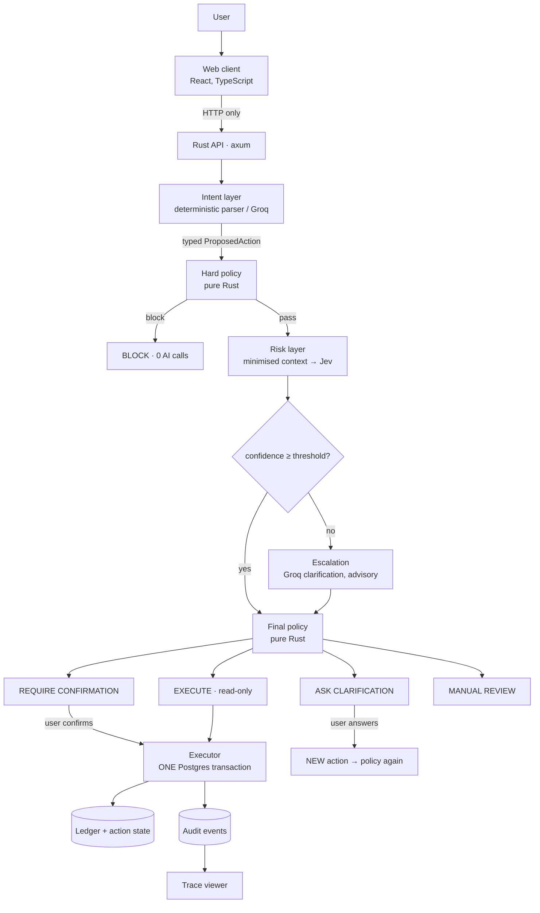
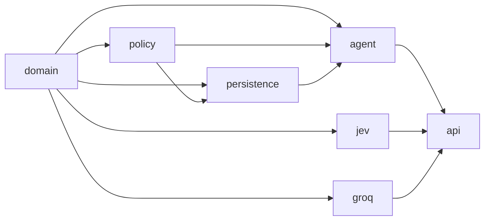
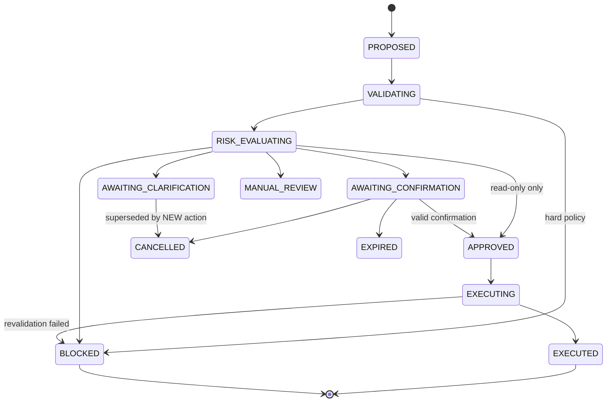

# Architecture

> Models propose. Policy decides. Executors execute.

## 1. The five layers



| Layer | Crate | May do | May **not** do |
|---|---|---|---|
| Intent | `agent`, `groq` | turn text into a structured intent; the model's amount/recipient must literally appear in the user's text | touch the DB, authorise, execute |
| Hard policy | `policy::hard` | check facts & invariants (ownership, balance, limits…) | call AI |
| Risk | `jev` | return probability distributions + confidence for 4 atomic questions | grant authority; remove confirmation |
| Escalation | `groq` | explain ambiguity, write one clarification question | recommend execution (the type has no such value) |
| Final policy | `policy::decide` | choose Execute / RequireConfirmation / AskForClarification / ManualReview / Block | do I/O |
| Executor | `persistence::executor` | the **only** code that changes financial state | trust earlier checks |

## 2. Crates and dependency direction



`domain` and `policy` have **no I/O**: everything in them is deterministic and unit-testable. Provider traits (`IntentParser`, `DecisionProvider`, `EscalationAnalyzer`) live in `domain`; adapters implement them; the `agent` receives them as `Arc<dyn Trait>`, so tests inject mocks.

## 3. Intent layer

`IntentParser::parse(text, ctx) -> ParsedIntent` where `ParsedIntent` is `{intent_type, recipient_reference, amount_minor, currency, missing_fields, ambiguity, refers_to_usual_amount}`.

* `DeterministicIntentParser`: rule based, offline, free — used by tests and as the fallback if the LLM parser fails.
* `GroqIntentParser`: strict JSON-schema output, then **server-side grounding**: an amount the user never wrote is discarded; a recipient reference not present in the text is discarded; `missing_fields` is recomputed (never trusted).
* The parsed intent is converted *immediately* into an `ActionDraft` (typed enum). Recipients are resolved against the user's own address book by deterministic code (`facts::resolve_recipient`). Unknown intents → `UNKNOWN_ACTION`; a model can never name an arbitrary function to run (`ActionKind::from_str` is the allow-list; `ToolSpec` registry carries risk class, permission, confirmation and Jev requirements).

`ActionDraft` vs `ProposedAction`: a draft may have missing fields ("send Alex the usual amount"). It can be risk-assessed and clarified but **cannot be executed**: only `draft.complete()` yields a `ProposedAction`, and only a complete action has a fingerprint and can receive a confirmation.

## 4. State machine



Illegal transitions return an error (`ActionStatus::transition`). Each DB transition is `UPDATE … WHERE id=$1 AND status=$from`, so a concurrent change is detected rather than overwritten. Terminal states have no exits (tested).

## 5. Policy

Order of rules in `policy::decide::stage_one` (first match wins):

1. **Hard policy block** → `Block` (no Jev, no Groq).
2. **Required Jev unavailable** (money movement) → `ManualReview` (fail closed).
3. **Incomplete action** → escalate (`MissingInformation`) → clarification.
4. **Severe signals** → `ManualReview`, or `Block` if both Jev scores are extreme. Includes a *model-free* rule: new recipient + amount ≥ 5× the usual maximum + unfamiliar device/location.
5. **Low confidence / insufficient context / intent mismatch** → escalate.
6. Otherwise the tool's base decision: confirmation for sensitive tools (always for transfers), execute for read-only.

`finalize_after_escalation` folds the advisory analysis back in. It can produce *clarification*, *manual review*, or fall back to the base decision. It cannot lower friction (a transfer stays at `RequireConfirmation`), and an incomplete action is always clarified regardless of what the model says. If the escalation provider fails, policy fails safe (clarify with a deterministic question, or manual review).

## 6. Risk context & minimisation

`RiskFacts` (everything we know, incl. the customer name, account number, balance) → `RiskContext::from_facts` → only an **allow-listed** set of fields: action type, scrubbed request, amount, ratio to typical, recipient age/known, device/location flags, hour velocity, usual range, missing fields. `RiskContext` is serialised as-is as the Jev `state`, so adding a field is the only way to expose more data — a reviewable diff. Tests assert names, account numbers, balances, emails and card numbers never appear in what leaves the server.

## 7. Jev adapter

* Transport: `reqwest` + `serde`, direct HTTP (no official Rust SDK exists). Per-attempt timeout (default 10 s), a hard total deadline, ≤1 bounded retry for timeouts/429/5xx with backoff, honouring `Retry-After` unless it is long; never retry 401 or 4xx validation errors.
* Question set `risk_questions_v1`: `intent_alignment` (Noul), `behavioral_anomaly` (Score 0–4), `recipient_risk` (Score 0–4), `context_sufficient` (Noul). Only questions supported by actual state are asked (an incomplete action gets only the two Noul questions).
* `parse_response` normalises both the JevStation envelope and TypeSafe's bare shape into `RiskAssessment` and validates distributions (sums, ranges, level counts). Vendor JSON never leaves the crate.
* Confidence: Choice/Score answers carry Jev's `confidence`; Noul answers do not, so we derive `|2p − 1|` (certainty of the yes/no call). `overall_confidence` is the **minimum** across answers present (weakest link). It is **not** a fraud probability and **not** an authorisation signal.

## 8. Groq adapter

`ChatBackend` trait → `GroqHttpBackend` (OpenAI-compatible `/chat/completions`, `response_format: json_schema` strict). If the provider rejects strict mode it degrades once to JSON mode; server-side validation (`deny_unknown_fields`, enums, grounding) applies either way. One repair retry for malformed output; typed `LlmProviderError`. The escalation schema's `recommended_handling` enum is `CONTINUE_POLICY | ASK_USER | REVIEW` — values like `EXECUTE_TRANSFER` fail deserialisation. Questions that mention an amount not supplied by the backend are discarded (`question_is_grounded`), and a deterministic fallback question is used.

## 9. Execution layer

`confirm_and_execute` — one transaction:

```
BEGIN
  SELECT … FROM actions WHERE id=$1 FOR UPDATE        -- serialise duplicate confirms
  idempotency: key seen? same fingerprint → return stored result; different → CONFLICT
  state gate: must be AWAITING_CONFIRMATION
  confirmation: right id, right user, unused, unexpired
  recompute fingerprint from stored fields == confirmation fingerprint   -- tamper check
  mark confirmation used; AWAITING_CONFIRMATION → APPROVED → EXECUTING
  SELECT … FROM accounts WHERE id = from FOR NO KEY UPDATE      -- the lock (customer row)
  re-run hard policy with the locked, fresh balance
  INSERT ledger_transactions + 2 ledger_entries; UPDATE balances (atomic +/-); INSERT history row
  EXECUTING → EXECUTED; audit events; idempotency record
COMMIT
```

A blocked revalidation commits the `BLOCKED` status and audit trail but moves no funds. Defence in depth at the DB: `CHECK (balance_minor >= 0)` on customer accounts, append-only triggers, and a **deferred constraint trigger** that rejects any unbalanced ledger transaction at `COMMIT`.

## 10. Database

| Table | Purpose |
|---|---|
| `users`, `devices`, `demo_sessions` | synthetic identity (stand-in for an IdP) |
| `accounts`, `cards`, `recipients`, `transactions` | state + user-facing history |
| `actions` | one row per proposal, explicit status, fingerprint, decision, result |
| `confirmations` | bound to action + fingerprint, expiry, single use |
| `idempotency_records` | `UNIQUE (user, scope, key)`, request fingerprint, stored response |
| `ledger_transactions`, `ledger_entries` | append-only, balanced double-entry-inspired ledger |
| `audit_events` | append-only, totally ordered by `seq`, `clock_timestamp()` timestamps |
| `jev_evaluations`, `groq_evaluations` | model audit: versions, latency, questions/answers or structured result, usage |

Money is `BIGINT` minor units everywhere.

## 11. Audit & trace

Every step writes an `audit_events` row (`request_received` … `execution_completed`). `GET /actions/:id/trace` rebuilds the lifecycle from `audit_events` + `jev_evaluations` + `groq_evaluations` + ledger, computes a stage summary, latency breakdown (intent / hard policy / Jev / Groq / DB), provider usage, and answers the "security value" questions (was Jev invoked? did the user confirm? did it happen once?). Versions (`policy_v1`, `risk_questions_v1`, `intent_schema_v1`, `escalation_schema_v1`) are embedded for reproducibility.

## 12. Observability

`tracing` spans: `http{request_id, trace_id}` → `command{trace_id}` → `action{action_id}` → `confirm{action_id}`. A redacting `MakeWriter` scrubs known secret values and token/Authorization/DB-URL patterns from every log line. Production logs are JSON.

## 13. Configuration & deployment

Everything is environment driven (`config.rs`). Providers default to mocks so `docker compose up` + `cargo run` works offline; real providers fail fast at startup if their key is missing. Migrations are embedded (`sqlx::migrate!`) and can use a separate direct URL.
